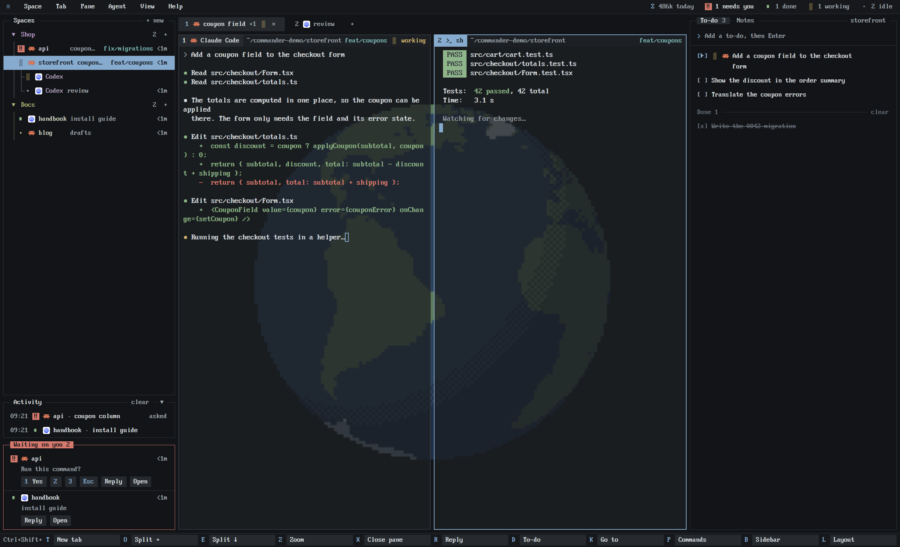

# Commander, a layout for Herdr

A text-mode workbench look for the [Herdr](https://herdr.dev) app: menu bar, a tree of spaces and agents, framed terminals, and a bar of your real shortcuts, in one sharp 8x16 pixel font. A side panel holds a to-do list for each space, shared with the agents working there, and a note for each space; the menu bar counts the tokens your agents used today. Behind the terminals, a pixel-art Earth drawn from real coastlines turns once a minute, and a small map at the foot of the sidebar marks where each of your machines is and the spot the globe is facing.



## Install

Herdr must already be installed. On Windows, open PowerShell in this repository and run:

```powershell
.\install.ps1 -SwitchLayout
```

The script uses `HERDR_APP_HOME` when set, otherwise `$HOME\.config\herdr-app`. Pass `-ConfigDir 'C:\path with spaces\herdr-app'` to select another folder. Omit `-SwitchLayout` to copy the files without changing the active layout. The switch uses `herdr-app` from `PATH`, waits for its result, and targets the selected config folder; if the command is unavailable, select Commander in Herdr after installing.

On macOS or Linux, copy `layouts/commander.json`, `layouts/commander.svg`, both `themes/commander*.json` files, `mods/cmdr-*`, and `backgrounds/commander-earth` into the corresponding paths under `~/.config/herdr-app/`. Merge the `layout:commander` entries in `keys.json` into your own keys file, keeping any binding you already use. Then run `herdr-app do layout.switch --name commander` or select it in the app. Back up any existing Commander files before replacing them. Do not replace the whole `mods`, `layouts`, or `themes` directory.

The Windows installer copies only Commander assets and leaves unrelated Herdr files alone. It backs up every existing file it replaces, including `keys.json`, under `.commander-backups/<timestamp>/` in the configuration folder. Identical files are skipped. Shortcut conflicts are reported and your existing bindings are kept. The script never deletes old files or installs hooks, Python, Git, GitHub CLI, or Herdr updates. Keep the backup folder until you have checked the layout.

Install or update Commander on **each machine** where you use it. Python 3.9 or newer is needed on each machine for the to-do and usage features. On Windows, the mod runtime tries the available Python commands, including the `py` launcher; a working Python interpreter must still be installed. Git is optional and supplies repository metadata in the tree; `gh` is optional and supplies GitHub pull request and check information when authenticated. Commander's `cmdr-*` mods and `commander*` layout/theme files are custom files that persist across Herdr app updates. Herdr's shipped files are recreated by the app, so do not edit them for Commander.

`RECIPE.md` describes the whole layout and how to build it from scratch.

What it runs and touches outside the app folder: `git` and, where it is installed, `gh` (which talks to GitHub) in your spaces' folders; Python scripts that read Claude Code's and Codex's own session logs (`~/.claude/projects`, `~/.codex/sessions`) for the usage meter and keep the to-do lists in `~/.herdr/todos/`; and `curl`, once a day on each machine, to ask `ipinfo.io` (or `ipapi.co`) where that machine's public address is, for the map. That lookup sends nothing but the request itself; delete the `map` block from the layout if you don't want it made. Nothing changes your agents' settings unless you run the optional `herdr-todo install` yourself: it adds a hook to Claude Code's and Codex's settings so new sessions are told about their space's list. `RECIPE.md` has the full list.

The globe costs a little while it turns (about 2% of one processor core, and the layout file is rewritten eight times a second). `View > Globe` switches it between revolving, still and off.

The bundled font is PxPlus IBM VGA 8x16 from The Ultimate Oldschool PC Font Pack by VileR (int10h.org), licensed CC BY-SA 4.0 (see `mods/cmdr-tree/fonts/LICENSE-PxPlus.txt`).

The globe was rendered from [Natural Earth](https://www.naturalearthdata.com) 1:50m outlines (public domain) by `backgrounds/commander-earth/render.py`.
