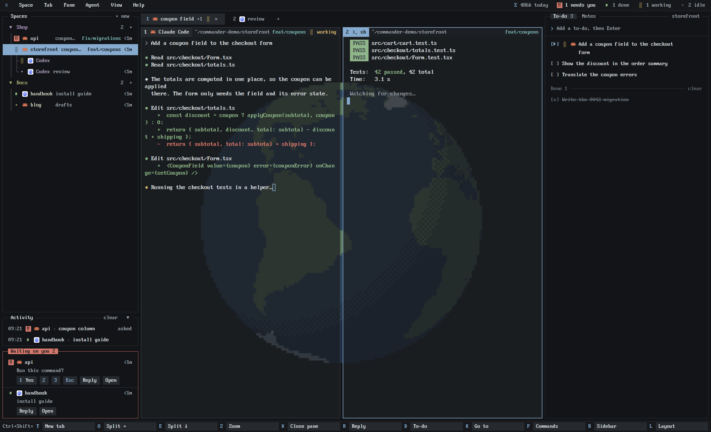

# Commander

A Herdr layout that looks and works like an old PC text-mode workbench: a menu bar on top, a framed tree of your spaces and agents on the left, framed terminals in the middle, and a bar of your real shortcuts at the bottom. Everything is set in one 8x16 pixel font, kept on the font's own pixel grid so it stays sharp. Colors are calm and low in saturation; each agent state has its own shape as well as its own color, and whatever needs you is collected in one box with the keys to answer it. Behind the terminals a pixel-art Earth, drawn from real coastlines, turns once a minute.



## What you see

Top to bottom, on a near-black canvas (`#121417`), in PxPlus IBM VGA 8x16 throughout (16 device pixels tall by default):

- **Menu bar**, one text row tall, full width. Left: `≡`, `Space`, `Tab`, `Pane`, `Agent`, `View`, `Help`. Right: the usage meter (`Σ` in accent, `2.9M today`, then `≈$50` dimmed: today's tokens and what they would cost at API list prices), then counts of agents by state (`1 needs you`, `1 done`, `1 working`, `2 idle`), each with its mark; states with no agents are left out. Where the system draws no window buttons, minimize, maximize and close follow.
- **Sidebar**, 306 px wide (180 to 480 by dragging), in a frame with its title `Spaces` set into the top border and `+ new` on the right.
  - Machines are the top level (the header is left out when there is only this computer). Under a machine: projects (your own groups), then spaces, then git worktree spaces under their checkout.
  - A space row: status mark, the agent's program icon, the space name, what the agent is on (tab name or terminal title, muted), a git tail (branch when it isn't the default one, `↑n` / `↓n`), and the time since the agent last changed state (`<1m`, `5m`, `3h`, `2d`).
  - More agents in the same space, and sub-agents without a pane, hang under the row on tree lines (`├`, `└`).
  - Each project has a soft hue, built from the theme's ANSI colors and kept off red, amber, green and blue. The project's name and arrow take the full hue; its sessions get a faint rail down their left, names tinted 30% toward the hue, idle dots and tree lines in the hue. Git branches are always the theme's cyan (`ansi6`).
  - The shown space is drawn in inverse video: accent background (`#86abcf`), dark text.
- **Waiting on you**, a second frame at the bottom of the sidebar, present only while an agent is blocked or done. Its frame and title are red (`#d77a6e`) if anything is blocked, green (`#8fb58a`) if agents are only done. Up to 3 entries: mark, icon, space name, time; then the question read from the agent's screen, or the tab name; then buttons.
- **Tab strip**, one row: a cell per tab of the shown space (`number`, program icon, name, `+N` for extra panes, status mark, `×` on the active one), a `+`, and on the right the side-panel buttons (`Notes`, and `Files` / `Changes` when the person enabled them).
- **Panes**, each in a 1 px frame (`#30353b`; the accent color while it has the keyboard), square corners, 5.56 px apart. Each has a header row: a tag with the pane's number, program icon and name (inverse while focused), the folder with `~` for home, the branch in cyan, and the agent's state in words (`working`, `needs you`, `done`).
- **Globe**, behind the panes and centred in the terminal area, as large as the area's shorter side allows: the Earth as pixel art, 112 globe pixels across, seen from the side with its axis leaning 23.4° to the right. Land, lakes, glaciers and the Antarctic ice shelves are where they really are (Natural Earth 1:50m outlines). Six muted colors: ocean `#2b425c`, land `#5d7a5a`, ice `#b4bfc9`, and a darker one of each (`#1f2e44`, `#3f5644`, `#768493`) on the side away from the light, which comes from the upper left; the edge of the shadow is a checkerboard dither. Terminals are half see-through (`terminal_opacity` 0.5) and panes have no fill of their own, so the globe shows through the text.
- **Side panel** (hidden until asked for), 368 px: a stack of the shipped `files` and `changes` mods and `cmdr-notes` (a markdown note per tab).
- **Key bar**, one row: the prefix most shortcuts share (`Ctrl+Shift+`) once on the left, then a cell per command: the last key in accent, the label on a raised cell. New tab, Split →, Split ↓, Zoom, Close pane, Reply, Go to, Commands, Sidebar, Layout.

Two themes ship with it: `commander` (graphite, dark: background `#1c1f23`, text `#d7dbe0`) and `commander-navy` (navy, used for the light appearance).

## How it behaves

Agent states, the same everywhere (tree, tabs, pane headers, menu bar, waiting box):

- **blocked**: `‼` in dark ink on a red square (`#d77a6e`).
- **done**: a green `■` (`#8fb58a`).
- **working**: an amber block that shimmers through `░ ▒ ▓ ▒`, one step every 280 ms (`#d2b570`).
- **idle**: a small `•`, in the project's hue or the theme's dim color.

Tree: click a space to show it; right-click for its menu (move to a project, new project, rename, close, worktrees, the app's full menu); drag a space to reorder it, onto a project to file it, onto a machine header to unfile it. Click an agent row to go to it. Hovering a row shows a `reply` button. A project header folds its sessions, counts them, and its `+` starts a new session in the project's folder. A machine header's `+` starts a space there; an unreachable machine says so in red, and one that needs a login offers `Log in ►`.

Waiting box: a blocked entry has `1 Yes`, `2`, `3` and `Esc`, which press that key in the agent's terminal; every entry has `Reply` (a dialog showing the agent's last lines and a text field, sent to the agent) and `Open` (go to its pane).

Menus: click a label to open it under the bar. Each item shows the key it is bound to, read live from `keys.json`. Esc closes it. View holds Sidebar, Notes, text size (`Bigger text`, `Smaller text`, `Sharpest text`), `Screen scale`, `Globe`, and the app's zoom.

Tabs: click to show, double-click to rename, drag to reorder, right-click for the tab menu, wheel for next and previous. `+` opens the shipped new-tab menu. The side panel's open view is remembered per space.

Pane header: click to focus; hovering shows `→` (split right), `↓` (split down), `Z` (zoom) and `×` (close).

Globe: it turns west to east, 0.75° a step, eight steps a second, one revolution a minute; the light stays put and the planet turns under it. `View > Globe` goes from `revolving` to `still` (the picture stays where it stopped) to `off` (no picture, panes filled with the theme background, terminals opaque) and back; the menu stays open so the next click moves on. Turning it on again starts from the first picture.

Usage: click the meter (or `≡ > Usage…`) for a popup under the bar's right end, framed `Usage · tokens`. Rows: each project's tokens today and over 7 days (in its hue, a faint band behind showing its share of the busiest), the four busiest unclaimed folders, the rest folded into `N more folders`; a Total; a bar a day for the week, today's in accent; Claude Code and Codex rows; Codex's own last word on its rate limit. `tok | $` in the frame's top border switches every number to dollars (title `Usage · API $`): each answer priced at its model's list rate, cache reads included, which the token view leaves out. The choice is remembered (shared `commander.usage-unit`). A click anywhere else closes it. The numbers refresh every 3 minutes while the window is active, and on opening the popup.

Key bar: click a cell to run it. A command with no key bound is not shown.

Keys added for this layout: `Ctrl+Shift+R` replies to the first waiting agent, `Ctrl+Shift+J` opens the project menu.

## Built from

`layouts/commander.json`: a root `column`, `titlebar: "none"`, not resizable, background `canvas`, `font` and `ui_font` "PxPlus IBM VGA 8x16", `font_size` 14, `terminal_padding` [8, 6], `terminal_opacity` 0.5, `theme: { light: "commander-navy", dark: "commander" }`.

```
root (column)
├─ menubar   block  cmdr-menubar   22.22 px, window_drag
├─ body      row    padding 5.56, gap 5.56
│  ├─ sidebar  block  cmdr-tree    305.56 px, min 180, max 480
│  └─ work     column gap 5.56
│     ├─ tabs       block  cmdr-tabs   22.22 px
│     └─ work-body  row
│        ├─ globe   column, not resizable, background { image: "backgrounds/commander-earth/479.png", fit: "contain" }
│        │  └─ main  block  background { image: "backgrounds/commander-earth/000.png", fit: "contain" },
│        │                  { tab: "active", pane: { header: cmdr-pane (top, always, 20.83 px),
│        │                    border 1 px "border", focus 1 px "accent", radius 0, gap 5.56, lone: true } }
│        └─ panel   column, hidden, 368 px → panel-body (stack: files, changes, notes = cmdr-notes)
└─ keybar    block  cmdr-keys      22.22 px
```

Mods, none with `props` of their own unless said:

- `cmdr-tree`: the sidebar. `projects.js` keeps projects in shared `spaces.projects` (`{ list: [{ id, name, machine, folder }], of: { spaceId: projectId } }`). With `props().menu` (`space`, `project`, `machine`) the same mod draws that popup menu. Commands: `cmdr-tree.reply`, `cmdr-tree.project`. Carries the font in `fonts/`.
- `cmdr-menubar`: the bar; with `props().menu` (a menu id) it draws that menu as a popup with `frame: "none"`. Commands: `cmdr-menubar.<herdr|space|tab|pane|agent|view|help>` open a menu; `.bigger`, `.smaller`, `.sharp`, `.scale`, `.rescale` change text size and screen scale; `.globe` moves the globe to its next setting. It also turns the globe: a 125 ms timer that, while shared `commander.globe` is `on` (the default; `still`, `off`) and `main` has a globe picture, copies `layout()`, sets `main.background.image` to the next of the 480 pictures and the `globe` node's to the one before it, and runs `layout.set`.
- `cmdr-tabs`, `cmdr-pane` (gets `{ pane, terminal }` from the app), `cmdr-keys`.
- `cmdr-usage` (a popup, `frame: "none"`, opened by `cmdr-menubar.usage`): only draws shared `commander.usage`. Its `usage.py` is what `cmdr-menubar` runs (`readUsage`, every 180 s while `window().active`, and on `cmdr-menubar.usage-refresh`): it reads the agents' own logs and prints today's and the week's tokens and API-price estimate by folder, day, agent and model. Projects claim a folder's usage when the folder is theirs, one of their spaces', or under one.
- `cmdr-reply` (`props: { terminal, label? }`, a dialog) and `cmdr-notes` (the notes panel).
- `ui.js`, the same file in six of the mods: `grid()`, `mark()`, `frame()`, `tag()`, `icon()`, `palette()`, `mix()`, `chord()`.

Shipped mods it opens: `menu`, `new-menu`, `picker`, `worktree`, `files`, `changes`, `machine-add`.

`herdr` functions: `spaces`, `machines`, `panes`, `agents`, `terminals`, `focused`, `layout`, `theme`, `settings`, `keys`, `shared` / `setShared`, `props`, `nextCommand`, `openOverlay` / `closeOverlay`, `setAgentOrder`, `run`, `exec`, `hc`, `watchFolder`, `readTextFile` / `writeTextFile`, `window`, `home`, `appHome`.

Commands it runs: `space.select`, `space.new`, `space.rename`, `space.close`, `space.move`, `space.next`, `space.prev`, `tab.new`, `tab.select`, `tab.rename`, `tab.move`, `tab.close`, `tab.next`, `tab.prev`, `pane.focus`, `pane.go`, `pane.split`, `pane.zoom`, `pane.close`, `terminal.peek`, `agent.next`, `agent.prev`, `layout.resize`, `layout.set`, `layout.toggle`, `layout.show`, `layout.hide`, `layout.select`, `layout.switch`, `mod.open`, `app.palette`, `app.help`, `app.settings`, `app.check_updates`, `app.whats_new`, `app.feedback`, `app.zoom_in`, `app.zoom_out`, `app.zoom_reset`, `window.minimize`, `window.maximize`, `window.close`.

Programs it runs and files it touches (tell the person before installing):

- `git` in each space's folder (branch, ahead/behind, changes, worktrees), on the space's own machine.
- `hc read` on waiting agents every 4 seconds (to find the question), `hc keys` and `hc send` when you answer, `hc machine ls`; `Log in ►` opens a tab running `hc machine login <machine>`.
- `hyprctl monitors -j` to learn the screen scale; where that isn't there, `herdr-app shot` to a temporary file and `od` on its header.
- While the globe revolves, `layout.set` makes the app rewrite `layouts/commander.json` and its saved clicks eight times a second.
- `cmdr-notes` reads and writes `~/.config/herdr-app/notes/<tab>.md`.
- `python3 mods/cmdr-usage/usage.py` here, and `python3 -c <its text>` on each other machine that has spaces: it reads `~/.claude/projects/**/*.jsonl` (Claude Code) and `~/.codex/sessions/**/*.jsonl` (Codex) from the last 8 days, and keeps a cache in `~/.cache/herdr-commander-usage.json`. Nothing it reads leaves the machine.
- `cmdr-tree` looks for `mods/retro-crew/main.js`, a crew launcher that is not part of this layout: only where that mod exists do a `Start a crew…` menu item and a `Crew` key cell (`cmdr-tree.crew`) show.
- No network access.

Art: the font is PxPlus IBM VGA 8x16 from The Ultimate Oldschool PC Font Pack by VileR (int10h.org), under CC BY-SA 4.0; its license is in `mods/cmdr-tree/fonts/`. Program icons are the app's own.

The globe is `backgrounds/commander-earth/000.png` to `479.png`: 312 × 312 px, transparent outside a 224 px disc (each globe pixel is 2 × 2), one picture per 0.75° of turn. `render.py` beside them made them (Python with numpy and Pillow): it paints Natural Earth's 1:50m land, lakes, glaciated areas and Antarctic ice shelves (public domain, naturalearthdata.com; GeoJSON from github.com/nvkelso/natural-earth-vector) onto an 8192 × 4096 map, then for each picture looks up every globe pixel through an orthographic projection, 5 × 5 samples a pixel, majority wins. The pictures as shipped: `render.py <folder with the four .geojson files> <out folder> 112 480 2 0.72`.

## Watch out

- **Nothing is sized in plain px.** The font is sharp only at 16 device pixels (or a whole multiple), so every size is counted in `u`, half a character cell: `u = (16k + bump) / 2 / (scale × zoom)`, where `k` is the multiple nearest an 11 px label. Text is `2u`, a row `4u`, one device pixel `1 / (scale × zoom)`. A build that writes `text_size(12)` gets blurred strokes.
- **A mod can't ask for the screen scale.** `cmdr-menubar` finds it (shared `commander.scale`): Hyprland first, else the frame's pixel width over the bar's width from `on_size_change`, which is already in window px with zoom applied. Without `sh` (Windows) it stays 1.6 until the person picks one in View > Screen scale; a wrong scale means soft text, nothing worse.
- **Bars follow the zoom.** A row's height in layout px changes with zoom and text size, so `cmdr-menubar` resizes `menubar`, `tabs` and `keybar` with `layout.resize`. The pane header's height (20.83) and the sidebar's width are fixed in the layout file; raise them by hand for much bigger text.
- `Bigger text` adds 2 device pixels a step (shared `commander.bump`, 0 to 16). Boxes stay on whole pixels; letters are softer off the font's native size.
- Popup `at` is in window px before zoom (multiply mod px by zoom); overlay `width` and `height` are after it.
- Mods can't import across folders: `ui.js` is copied into each mod. Change one, copy it to the others.
- Terminal text is the layout's `font_size` 14, not on the grid; it is as sharp as the app's own text rendering makes it.
- The pane title is a tag in the header's corner, not set into the border line: the app draws pane borders.
- `cmdr-reply`, `cmdr-notes` and the shipped menus it opens are sized in ordinary px, not on the grid.
- Menu labels have no Alt-letter hotkeys. Inside an open menu, Up, Down and Enter are handled in code but this build was only exercised with the mouse and by command.
- The answer buttons press keys blindly: they suit agents whose prompts take `1`, `2`, `3` and Esc.
- Animate the working mark with `.frames(...)`, never a timer.
- **The $ figure is an estimate at API list prices**, not what a subscription bills. Prices are a hand-kept table (`PRICES` in `usage.py`, $ per million tokens: input, output, 5-minute and 1-hour cache write, cache read), matched by the longest prefix of the logged model id; a model not in it is counted as unpriced, never as $0. Claude Code's cache writes are hour-long ones (2× input); fast mode doubles Claude's rates; Haiku 5.5's 5× over 100K-token prompts is applied, other long-context surcharges are not. Update the table when prices or models change.
- Codex logs running totals per session: an answer's usage is the difference from the one before, and a session continued from another starts with that one's total, so its first answer is the `last_token_usage`.
- Bump `VERSION` in `usage.py` whenever an entry's shape changes, or the cache keeps the old shape.
- **The app does not animate a layout background.** An animated GIF or WebP shows its first frame, and a picture is cached by its path, so overwriting the file changes nothing. The globe turns by naming a different file each step, through `layout.set`.
- **A picture shown for the first time leaves its block bare for a moment**, which reads as flicker on the first revolution. That is what the `globe` wrapper is for: it shows the previous picture, already loaded, in the same place under `main`. `main` must be its only child, with no gap or padding, or the two globes won't line up.
- **The globe has a running cost.** Measured on one Linux laptop while revolving: about 2% of one processor core, about 68 kB a second written to disk (the layout file, each step), and about 190 MB of memory for the 480 loaded pictures. `still` stops the first two. At one step a second the motion ticks visibly; that is why it is eight.
- The layout file is rewritten eight times a second while the globe revolves: set it to `still` before editing `layouts/commander.json` by hand, or your edit is overwritten.
- Copy `backgrounds/commander-earth/` along with the layout and mods. Without the folder there is no globe, only half see-through terminals; `View > Globe`, clicked through to `off`, puts the pane fill back.
- The pictures are scaled to the terminal area (`fit: "contain"`), so unlike the text, the globe's pixels do not sit on the screen's pixel grid.
- A new set of pictures needs a new folder name while the app runs (the cache again); then change `GLOBE.dir` and `GLOBE.frames` in `cmdr-menubar/main.js` and the two paths in the layout.

## Done when

- `herdr-app check` passes for each of the eight mods, and `layout.switch {name: "commander"}` shows the window with no `layouts/commander.error`.
- A screenshot enlarged 4× shows single-pixel strokes in the menu bar, tree and key bar, at zoom 0.9 and 1.
- After `app.zoom_in`, the three bars are still exactly one text row tall.
- A terminal reporting `state=blocked` (OSC 7501) shows `‼` on its row, raises the menu bar's `needs you` count, and appears in a red "Waiting on you" box with the last line ending in `?` from its screen; killing it removes all three.
- `herdr-app do cmdr-menubar.view` opens the View menu directly under its label, flush with the bar.
- Each key bar cell names a key that is bound in `keys.json`, and unbinding one removes its cell.
- Two projects on one machine show two different hues, and their sessions carry them.
- `python3 mods/cmdr-usage/usage.py` prints JSON whose `cost` is `[today, week]` in dollars and whose `models` lists every model in the logs; working out one model's week by hand (tokens × the table's rates) matches its `models` entry.
- The bar shows `Σ … today ≈$…`; `herdr-app do cmdr-menubar.usage` opens the popup, and clicking `$` turns every number, the day bars and the title to dollars.
- With the globe revolving, the number in `main`'s `background.image` in `layouts/commander.json` goes up by about eight a second and follows `479` with `000`, and screenshots taken in quick succession all show a globe.
- `herdr-app do cmdr-menubar.globe` once stops that number; again removes `background` from `main` and `globe`, gives `pane` the fill `background` and sets `terminal_opacity` to 1; a third time puts picture `000` back and it turns again.
